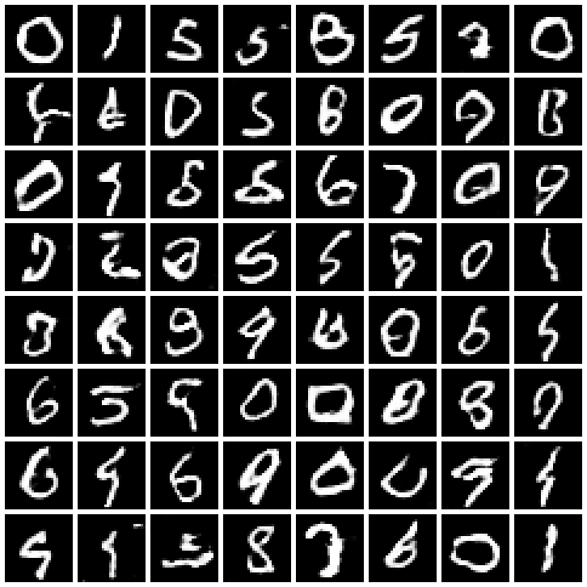

# SPS GenAI: Text Generation and Word Embedding API

FastAPI service for Applied Generative AI:

- **Module 3 class activity:** text generation with a bigram language model
- **Assignment 1:** word embeddings and similarity with spaCy's `en_core_web_lg` (as in the Module 2 practical)
- **Assignment 2:** a CNN image classifier trained on CIFAR-10 (architecture below)
- **Assignment 3:** a GAN trained on MNIST that generates handwritten digits

## Project structure

```
sps_genai/
├── app/
│   ├── bigram_model.py     # bigram probabilities and text generation
│   ├── cnn_model.py        # SimpleCNN architecture and image classifier
│   ├── embedding_model.py  # spaCy embeddings and similarity
│   ├── gan_model.py        # GAN generator and discriminator
│   ├── main.py             # API endpoints
│   └── weights/
│       ├── cnn_cifar10.pt           # trained CNN weights
│       └── gan_generator_mnist.pt   # trained GAN generator weights
├── tests/
│   ├── test_api.py
│   ├── test_cnn.py
│   └── test_gan.py
├── samples/                # one CIFAR-10 test image per class, for trying /classify
├── train_cnn.py            # trains the CNN on CIFAR-10
├── train_gan.py            # trains the GAN on MNIST
├── Dockerfile
├── pyproject.toml
└── uv.lock
```

## Run with Docker

```bash
docker build -t sps-genai .
docker run -p 8000:80 sps-genai
```

Then open http://127.0.0.1:8000/docs. The image is about 2.4 GB because it includes the spaCy `en_core_web_lg` model and PyTorch (CPU build), so the first build takes a few minutes.

## Run locally with uv

```bash
uv sync
uv run fastapi dev app/main.py
uv run pytest
```

## CNN image classifier (Assignment 2)

`SimpleCNN` in `app/cnn_model.py` follows the assignment's architecture:

| Layer | Output shape |
|---|---|
| Input (RGB image) | 3 × 64 × 64 |
| Conv2D, 16 filters, 3×3, stride 1, padding 1 + ReLU | 16 × 64 × 64 |
| MaxPool 2×2, stride 2 | 16 × 32 × 32 |
| Conv2D, 32 filters, 3×3, stride 1, padding 1 + ReLU | 32 × 32 × 32 |
| MaxPool 2×2, stride 2 | 32 × 16 × 16 |
| Flatten | 8192 |
| Fully connected + ReLU | 100 |
| Fully connected | 10 |

CIFAR-10 images are 32×32, so they are resized to 64×64 to match the input size. Uploaded images of any size are resized the same way.

The model was trained for 10 epochs with Adam (learning rate 0.001, batch size 32, random horizontal flips) and reaches **67.4% accuracy on the CIFAR-10 test set**. The trained weights are committed in `app/weights/`, so the API and Docker image do not need to retrain. To retrain (downloads CIFAR-10, about 170 MB):

```bash
uv run python train_cnn.py --epochs 10
```

## GAN digit generator (Assignment 3)

`app/gan_model.py` follows the assignment's architecture.

**Generator** (noise in, image out):

| Layer | Output shape |
|---|---|
| Input noise | 100 |
| Fully connected, reshape | 128 × 7 × 7 |
| ConvTranspose2D 128 → 64, kernel 4, stride 2, padding 1 + BatchNorm + ReLU | 64 × 14 × 14 |
| ConvTranspose2D 64 → 1, kernel 4, stride 2, padding 1 + Tanh | 1 × 28 × 28 |

**Discriminator** (image in, real/fake probability out):

| Layer | Output shape |
|---|---|
| Input image | 1 × 28 × 28 |
| Conv2D 1 → 64, kernel 4, stride 2, padding 1 + LeakyReLU(0.2) | 64 × 14 × 14 |
| Conv2D 64 → 128, kernel 4, stride 2, padding 1 + BatchNorm + LeakyReLU(0.2) | 128 × 7 × 7 |
| Flatten, Linear + Sigmoid | 1 |

Training uses MNIST scaled to [-1, 1] (to match Tanh), binary cross-entropy, and Adam (learning rate 0.0002, betas 0.5 and 0.999, batch size 128) for 20 epochs. Only the generator weights are needed to serve the API. To retrain:

```bash
uv run python train_gan.py --epochs 20
```



## Endpoints

| Method | Path | Description |
|---|---|---|
| GET | `/` | Hello World |
| GET | `/health` | Health check |
| GET | `/vocabulary` | Every word the model knows |
| GET | `/next_words/{word}` | Probability of each word that can follow `word` |
| POST | `/generate` | Generate text from a start word |
| GET | `/embedding/{word}` | 300-dimensional embedding for `word` (`?limit=N` returns the first N values) |
| GET | `/similarity?word1=&word2=` | Cosine similarity between two words |
| POST | `/classify` | Upload an image (`file`), get its CIFAR-10 class and the probability of each class |
| GET | `/classes` | The 10 classes the classifier can predict |
| GET | `/gan/digits?count=16&seed=1` | PNG grid of GAN-generated digits (`count` 1–64; same `seed` gives the same digits) |

### Examples

```bash
curl -X POST http://127.0.0.1:8000/generate \
  -H "Content-Type: application/json" \
  -d '{"start_word": "the", "length": 10}'
# {"generated_text": "the count of monte cristo is a novel written by alexandre"}  (output is random)

curl http://127.0.0.1:8000/next_words/bigram
# {"word": "bigram", "next_word_probabilities": {"probabilities": 0.5, "models": 0.5}}

curl "http://127.0.0.1:8000/embedding/apple?limit=5"
# {"word": "apple", "model": "en_core_web_lg", "dimension": 300, "embedding": [-0.3639, 0.4377, -0.2045, -0.2289, -0.1423]}

curl "http://127.0.0.1:8000/similarity?word1=apple&word2=orange"
# {"word1": "apple", "word2": "orange", "similarity": 0.5619}

curl -X POST http://127.0.0.1:8000/classify -F "file=@samples/ship.png"
# {"filename": "ship.png", "class": "ship", "confidence": 0.90, "probabilities": {"airplane": 0.02, ...}}

curl "http://127.0.0.1:8000/gan/digits?count=16&seed=1" -o digits.png
```

`length` must be between 1 and 100. Generation stops early at a word that nothing follows in the corpus. Words without an embedding return 404.
